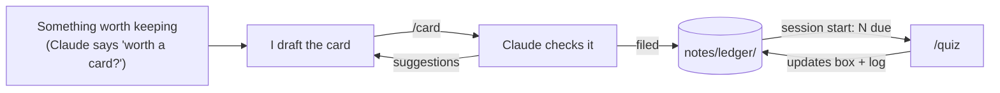

# Ledger

Things I've learned in this project, written as cards I review on a
schedule. Retrieving something from memory, spaced out over time, is what
makes it stick. Re-reading notes doesn't.

## Workflow

## Card types

- **recall**: a question with a short answer. Best for concepts and
  *why* questions: "Why does a fixed timestep need an accumulator?"
- **exercise**: a task I do in the terminal or repo. Best for skills:
  "Find every file under `tools/` that calls an SDL function."

## Schedule (Leitner boxes)

Each card has a `box` from 1 to 5. A right answer moves it up one box. A
wrong answer sends it back to box 1. A card is due when
`last_reviewed + interval <= today`.

| Box | Interval |
|---|---|
| 1 | 1 day |
| 2 | 3 days |
| 3 | 1 week |
| 4 | 3 weeks |
| 5 | 2 months |

Cards I know well end up in box 5 and cost almost nothing, so there's no
need to delete them.

## File format

One file per card: `<slug>.md`, where the slug names the idea. Copy
[_template.md](_template.md). The SessionStart hook
(`tools/ledger_due.sh`) reads the `box` and `last_reviewed` lines, so keep
those as written: one value each, date as `YYYY-MM-DD`.

## Good cards (short version)

One idea per card. Ask *why* or *what happens*, not just *what is*. The
answer should be short and checkable. Longer reading:

- Andy Matuschak, [How to write good prompts](https://andymatuschak.org/prompts/)
- Michael Nielsen, [Augmenting Long-term Memory](https://augmentingcognition.com/ltm.html)
